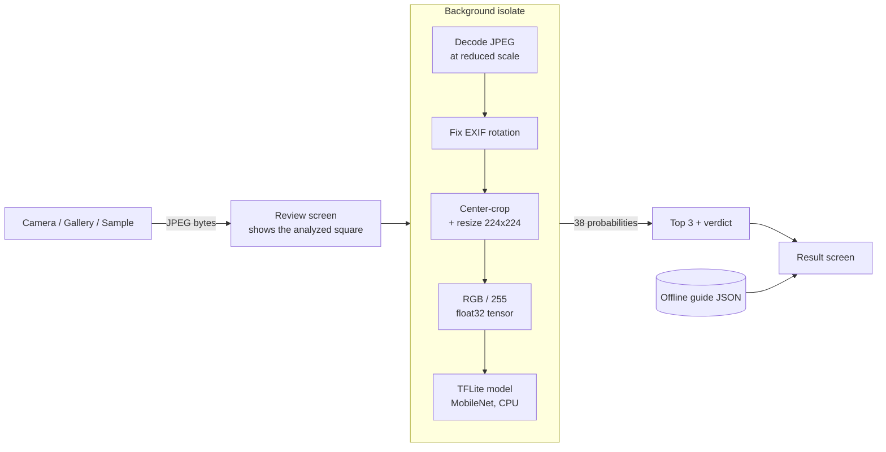

# SmartCrop: On-Device Plant Disease Classification

SmartCrop is a Flutter app that checks plant leaves for diseases using a TensorFlow Lite model that
runs **entirely on the phone**. It works with no internet after installation, for farmers in areas
with poor connectivity.

*Elective 4 (Special Topics in IT), Activity 5.*

## Features

| Deliverable | What the app does |
|---|---|
| Camera capture and image processing | In-app camera with a square guide frame showing exactly what the model sees, tap to focus and a flashlight toggle. Gallery picker and bundled sample leaves are also available. Photos are decoded, rotated upright (EXIF), center-cropped, resized to 224 × 224 and normalized. |
| On-device disease classification | Kaggle plant-disease TFLite model (38 classes, 14 crops) run with LiteRT on the CPU in a background isolate. |
| Results display | Color-coded verdict (Healthy, Disease/Pest detected, or Not sure), confidence meter, "also possible" runner-up, and other possibilities. Sample leaves show whether the result matches the expert label. |
| *(Optional)* Actionable guidance | An **offline** guide for all 38 classes covering cause, signs, what to do now and prevention. Urgent conditions get an "Act today" warning. Also browsable as a disease library from the home screen. |

## How it works



- The model and the guide start loading when the app opens, so they are ready by the first scan.
- Each analysis runs in a background isolate, so the UI never freezes. Overlapping calls are queued.
- The result screen looks up the top label in the bundled guide.

### Project structure

```
lib/
  main.dart                     App entry; starts loading model + guide
  models/                       PlantLabel, ClassificationResult (verdict logic), DiseaseGuide, LeafPhoto
  services/
    plant_classifier.dart       Loads the model, runs inference in a background isolate
    image_preprocessor.dart     Decode, rotate, crop, resize, normalize
    guide_book.dart             Loads the offline guide
    app_services.dart           Makes classifier + guide available to all screens
  screens/                      Home, camera, photo review, result, disease guide
  widgets/                      Crop guide overlay, sample picker, guide view
  data/sample_leaves.dart       Bundled sample photos and their expert labels
assets/
  models/plant_disease.tflite   The Kaggle model (12.95 MB)
  labels/labels.txt             38 class names in model output order
  guide/disease_guide.json      Offline guidance for every class
  samples/                      8 PlantVillage leaf photos
docs/MODEL.md                   Model inspection and accuracy check details
integration_test/               On-device model checks
test/                           Unit and widget tests
tool/inspect_tflite.js          Reads tensor details out of a .tflite file
```

## The model

[rishitdagli/plant-disease](https://www.kaggle.com/models/rishitdagli/plant-disease/tfLite) by
Rishit Dagli (Apache 2.0). It was trained on PlantVillage (about 54,000 leaf images, 38 classes).
The file was read directly with `tool/inspect_tflite.js` to confirm the details:

- **Input:** `[1, 224, 224, 3]` float32, RGB scaled to `[0, 1]`
- **Output:** `[1, 38]` float32. The last op is **softmax**, so the outputs are already probabilities, although the Kaggle page calls them logits.
- **Architecture:** the layer layout is MobileNet v1 (no residual adds), although the page says v2.

Full details are in [docs/MODEL.md](docs/MODEL.md).

## Offline by design

- **No `INTERNET` permission** in the release app. The only permissions are `CAMERA` and
  `ACCESS_NETWORK_STATE` (a normal, non-dangerous permission added by a camera library).
- The model, labels, guide and sample photos are all bundled in the APK.
- Photos stay in memory. The camera's temporary file is deleted right after capture.
- Permissions that libraries request but SmartCrop does not need (microphone, storage, phone state)
  are removed in `AndroidManifest.xml`.

## Optimizations

| Optimization | Measured effect |
|---|---|
| Per-ABI APKs (`--split-per-abi`) | arm64 APK **49.3 → 33.4 MB (−32%)**; the old APK carried TFLite libraries for 3 other CPU types |
| Unused GPU-delegate library left out | −2.4 MB per ABI (included in the figure above) |
| Gallery photos downscaled natively to ≤1600 px before Dart sees them | Preprocessing **350 → 98 ms** compared with a 12 MP photo (emulator, release) |
| JPEG decoded at reduced scale (1/2, 1/4, 1/8) when the photo is large | 12 MP preprocessing **393 → 266 ms (−32%)** (laptop benchmark) |
| Camera captures at 720p (the model only needs 224 × 224) | Smaller photos to decode, about 81 ms preprocessing |
| Model loaded once at startup, inference in a background isolate | Smooth UI; about 20–30 ms per inference (emulator) |
| Guide frame on the camera matches the model's center crop | Users frame exactly what the model analyzes |

**Not done: model quantization.** Converting the model to float16 (about 6.5 MB) or int8 dynamic
range (about 3.5 MB) would shrink it further. Both need the TensorFlow converter in Python.

## Results

On-device check: release build, Android emulator (Pixel 8, API 31, x86_64), 8 PlantVillage sample leaves.

| Preprocessing | Correct | Mean top-1 confidence | Avg inference |
|---|---|---|---|
| **RGB / 255 → `[0, 1]` (used)** | **7 / 8** | 88.5% | 31 ms |
| RGB / 127.5 − 1 → `[−1, 1]` | 6 / 8 | 87.0% | 27 ms |

| Photo size | Preprocess | Inference |
|---|---|---|
| Camera 1280 × 720 | 81 ms | 27 ms |
| Gallery 1600 × 1200 | 98 ms | 21 ms |
| 12 MP 4000 × 3000 | 350 ms | 18 ms |

On a real phone (vivo 1919, Android 12), the app reported 206 ms for its first full analysis of a
sample leaf, including warm-up.

The one miss: `tomato_early_blight.jpg` comes out as *Septoria leaf spot* (90.8%), with *Early
blight* second. The two look alike, which is why the app always shows the other possibilities.

## Limitations

- **Closed set.** The model always picks one of its 38 classes and cannot say "unknown". Photos of
  unsupported plants (mango, rice, banana...) still get a crop name, often tomato or bell pepper,
  sometimes with high confidence. The "Not sure" verdict (<60%) catches only some of these.
- **Lab vs field photos.** PlantVillage photos show single leaves on plain backgrounds. The
  dataset's authors reported accuracy falling to about 31% on photos taken in different conditions
  (Mohanty et al., 2016). The app's tips and guide frame help, but field accuracy will be lower.
- **Uneven classes.** Orange and squash have only one disease class each, and blueberry,
  raspberry and soybean have only a healthy class. The guide warns about this for those crops.
- **Guide content** is general guidance written for this project and has not been reviewed by an
  agriculturist. It gives no pesticide doses and tells users to follow product labels and their
  Municipal Agriculture Office.
- Tested on Android only. iOS needs a Mac to build.
- English only.
- The release APK is signed with the debug key. Use your own keystore before publishing.

## Build and run

Requirements: Flutter 3.47+, Android SDK, JDK 17.

```powershell
flutter pub get
flutter test                      # 44 unit and widget tests
flutter run                       # debug run on a connected phone
```

Release build (one APK per CPU type):

```powershell
flutter build apk --release --split-per-abi --split-debug-info=build/debug-info
```

Most phones need `build/app/outputs/flutter-apk/app-arm64-v8a-release.apk`:

```powershell
adb install -r build/app/outputs/flutter-apk/app-arm64-v8a-release.apk
```

### On-device model check

`integration_test/model_check_main.dart` is a small separate app that runs every sample through
the real model in release mode, then logs accuracy and timings to the screen and to `logcat`
(lines start with `MODELCHECK`). The steps are at the top of the file.

## Credits

- Model: Rishit Dagli, [Kaggle](https://www.kaggle.com/models/rishitdagli/plant-disease), Apache 2.0
- Dataset and sample photos: PlantVillage (Hughes & Salathé, 2015), via
  [github.com/spMohanty/PlantVillage-Dataset](https://github.com/spMohanty/PlantVillage-Dataset)
- Mohanty, S. P., Hughes, D. P., & Salathé, M. (2016). *Using Deep Learning for Image-Based Plant
  Disease Detection.* Frontiers in Plant Science, 7, 1419.
"# smart-crop" 
